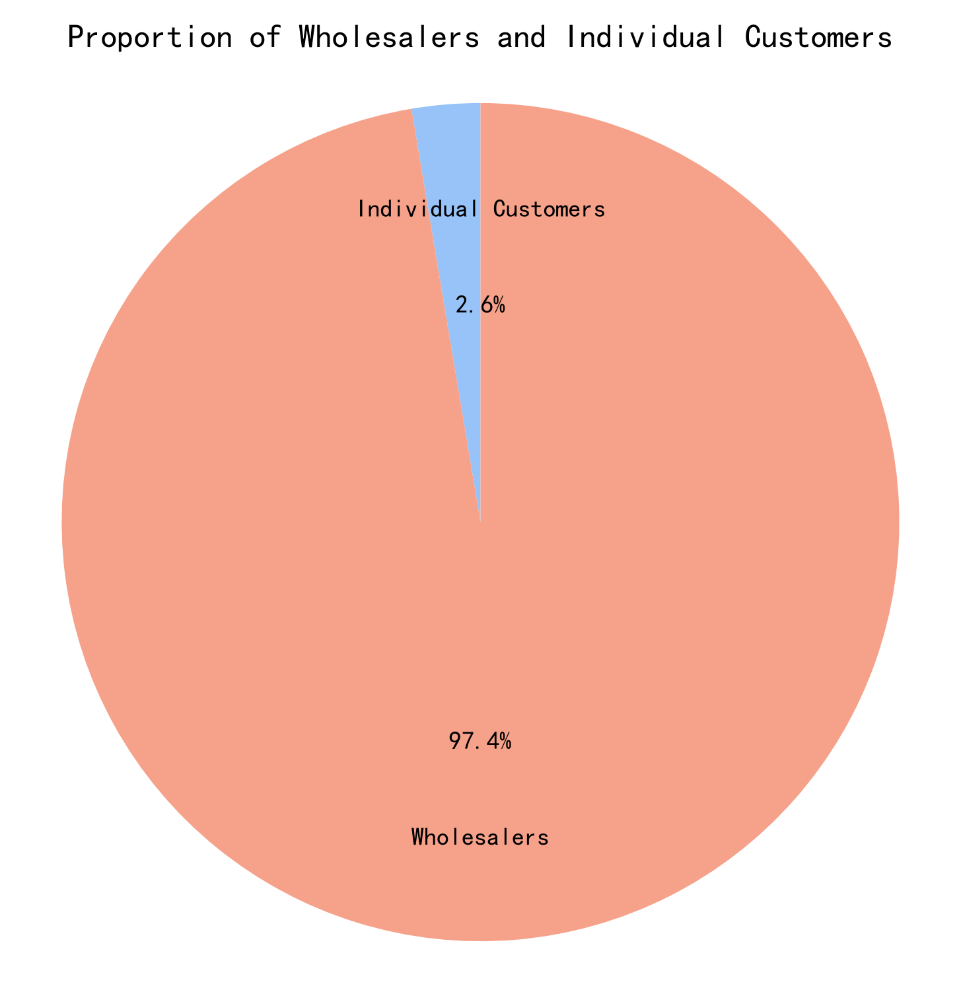

# RFM Analysis Based On Online Retail II

## Overview

RFM (Recency, Frequency, Monetary) is a classic model for user segmentation and marketing strategy formulation. Based on the Online Retail II dataset, this project distinguishes between wholesalers and individual customers in the dataset. Considering that most customers are wholesalers, RFM analysis is only conducted on wholesalers, and feasible strategies are proposed.

## About Dataset

### Context
This Online Retail II data set contains all the transactions occurring for a UK-based and registered, non-store online retail between 01/12/2009 and 09/12/2011.The company mainly sells unique all-occasion gift-ware. Many customers of the company are wholesalers.

### Content
- InvoiceNo: Invoice number. Nominal. A 6-digit integral number uniquely assigned to each transaction. If this code starts with the letter 'c', it indicates a cancellation.
- StockCode: Product (item) code. Nominal. A 5-digit integral number uniquely assigned to each distinct product.
- Description: Product (item) name. Nominal.
- Quantity: The quantities of each product (item) per transaction. Numeric.
- InvoiceDate: Invoice date and time. Numeric. The day and time when a transaction was generated.
- UnitPrice: Unit price. Numeric. Product price per unit in sterling (£).
- CustomerID: Customer number. Nominal. A 5-digit integral number uniquely assigned to each customer.
- Country: Country name. Nominal. The name of the country where a customer resides.

Dataset Link: [https://www.kaggle.com/datasets/mashlyn/online-retail-ii-uci](https://www.kaggle.com/datasets/mashlyn/online-retail-ii-uci)

## Introduction to RFM

- **Recency (R):**

Represents the time that has passed since a customer's last purchase. Customers with more recent purchases are generally considered more valuable, as they are likely to engage in repeated transactions.

- **Frequency (F):**

Indicates how often a customer makes purchases within a specific time frame. Customers who shop frequently are often considered more loyal and valuable.

- **Monetary (M):**

Refers to the total amount of money a customer has spent. Customers who have made significant purchases are often more financially impactful and potentially more responsive to special offers.

## Customer Classification

Customers in the dataset are divided into wholesalers and individual customers. These two types of buyers show distinct purchasing characteristics. Therefore, to carry out RFM analysis effectively, I separated the two customer groups based on data features.

It can be seen that wholesalers dominate the dataset (97.4%). Almost all revenue of this platform comes from them. Therefore, for business considerations, I limit RFM analysis to wholesalers only.

## RFM Analysis for Wholesalers

### Segments

I set three thresholds to divide each of the three RFM metrics for wholesalers into high and low groups. Combining these three metrics, wholesalers are classified into 8 segments:
- High-value Active Wholesaler (R-High, F-High, M-High)
- Frequent Small-order Wholesaler (R-High, F-High, M-Low)
- Infrequent Large-order Wholesaler (R-High, F-Low, M-High)
- Low-activity New Wholesaler (R-High, F-Low, M-Low)
- Dormant High-value Wholesaler (R-Low, F-High, M-High)
- Dormant Frequent Small-order Wholesaler (R-Low, F-High, M-Low)
- Dormant Infrequent Large-order Wholesaler (R-Low, F-Low, M-High)
- Dormant Low-Value Wholesaler (R-Low, F-Low, M-Low)

### Methods

- **For F & M:**

Frequency and Monetary are split by median.
 
- **For Recency:**

For wholesalers, the restocking cycle is a key factor that helps me determine the Recency (R) level. However, the dataset does not capture restocking cycles for all wholesalers. For example, a wholesaler only places bulk orders on this platform in emergencies, and their purchasing pattern on this platform can be classified as unstable. Therefore, a secondary indicator: stability, needs to be introduced.

The coefficient of variation (CV) is introduced to measure the stability of intervals between consecutive orders. For wholesalers with multiple purchase records, if CV ≤ 1, their purchasing rhythm is relatively stable; if CV > 1, the intervals between orders are highly dispersed and there is no stable restocking cycle. Based on this, I assign a stability label to each wholesaler.

Customers with three or fewer orders have limited observations of replenishment intervals. Such a small sample of gaps cannot generate a valid coefficient of variation, so these customers are tagged as Flexible and excluded from benchmark threshold calculation.

For all wholesalers tagged as Stable, their average replenishment cycle is calculated as 79.43 days, which is used as the threshold to judge the level of Recency.

### Result
The final RFM segmentation result is generated. The number of wholesalers in eight categories is shown in the figure below:

## Strategies for Wholesalers

- **High-value Active Wholesaler (R-High, F-High, M-High)**

Offer priority shipment and exclusive pricing, and maintain regular check-ins to retain this core group.

- **Frequent Small-order Wholesaler (R-High, F-High, M-Low)**

Launch bundle and threshold discounts to encourage larger order sizes while sustaining regular contact.

- **Infrequent Large-order Wholesaler (R-High, F-Low, M-High)**

Monitor their purchasing trend, and send stock and quotation alerts when major new products or bulk discounts launch.

- **Low-activity New Wholesaler (R-High, F-Low, M-Low)**

Provide small-batch introductory offers to lower trial barriers and drive repeat purchases.

- **Dormant High-value Wholesaler (R-Low, F-High, M-High)**

Deliver targeted bulk purchase incentives and investigate reasons for inactivity to win them back.

- **Dormant Frequent Small-order Wholesaler (R-Low, F-High, M-Low)**

Use low-cost small-order promotions for reactivation and avoid excessive discount investment.

- **Dormant Infrequent Large-order Wholesaler (R-Low, F-Low, M-High)**

Notify them only during seasonal promotion windows, and avoid frequent, disruptive outreach.

- **Dormant Low-value Wholesaler (R-Low, F-Low, M-Low)**

No strategies to be adopted.